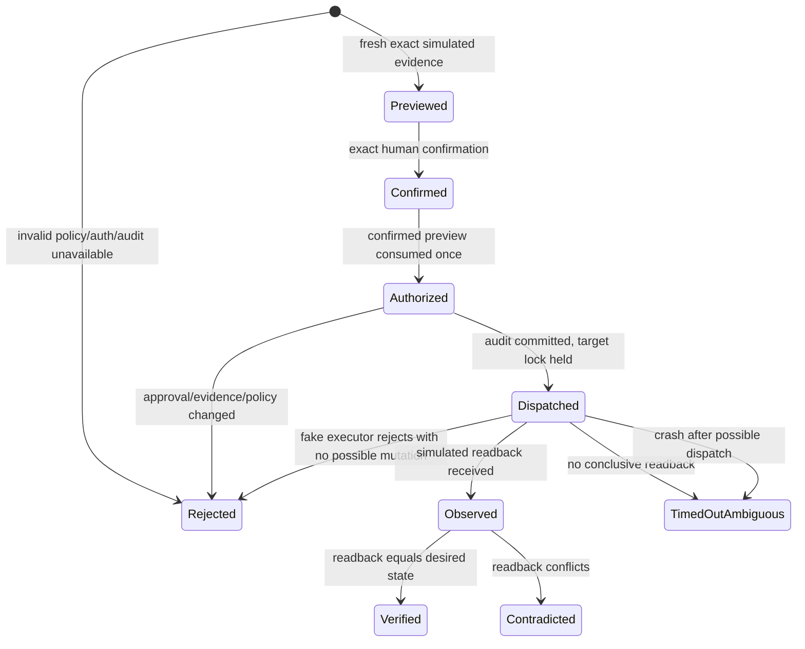

# Phase C0 supervised simulated execution

Phase C0 adds one **separate, disabled-by-default simulation harness**. It does not add mutation routes to the Control Deck and cannot contact a device, broker, URL, shell, or service.

## Authority contract

| Concern | Authority | Never implies execution permission |
|---|---|---|
| Significance and adopted commitment | BenLab | `attention_state: now` |
| Capacity evidence | schedule-assessment | `fit_status: fits` |
| Observed readiness and opportunity | homeauto | `state: available` |
| One exact attempt | Authenticated human in the simulation boundary | Any LLM, job, MQTT event, or Analyst result |
| Dispatch | Closed `indicator.set` fake executor | Any production adapter |
| Result evidence | Fresh simulated readback | Physical verification |

The only command is `indicator.set`, target `fixture:indicator-01`, desired state `on` or `off`. An authenticated operator may authorize one exact request only after preview. The approval binds operator, action, target, expected and desired states, evidence identity/version, request identity, idempotency identity, and expiration. Request bodies cannot carry an actor identity.

`homeauto-world-state@1.1.0` remains read-only. BenLab action IDs and homeauto opportunity IDs are references in receipts, not delegated authority. schedule-assessment remains read-only capacity evidence. machine-docs remains physical identity/safety authority; the Phase C0 fixture is not a physical-machine identity.

## Sequence and state machine



`Verified` means only that fresh deterministic simulator readback matched the requested state. Every receipt says `simulation: true`, `verification_kind: simulated_platform_readback`, and `physically_verified: false`.

Preview creates a short-lived server-side confirmation record whose random identifier is stored only as a hash and is never returned to the caller. Approval presents the exact action, target, state transition, and request identity through macOS LocalAuthentication and requires the operating system to verify device-owner presence (Touch ID or the OS account credential); no text confirmation is accepted through the Python API, stdin, or a pseudo-terminal. The confirmed preview is consumed atomically when the approval is created. Execution then authenticates and validates once while claiming the target and again immediately before recording dispatch. A service-wide operation lock excludes recovery while execution is live, and the policy lock remains held through the closed fake dispatch and terminal journal update. The authorized event must commit before the fake executor is called. Expiration, revocation, kill-switch engagement, or changed evidence prevents dispatch.

## Threat model

| Threat | Phase C0 control | Fail-closed result |
|---|---|---|
| Anonymous/forged actor | Identity comes only from the test identity provider; actor fields are rejected | Rejected |
| Approval without human confirmation | No confirmation capability or text-response path is returned; approval requires macOS LocalAuthentication to verify device-owner presence for the exact preview | Rejected |
| Unauthorized/revoked operator | Allowlist and credential status checked at preview, approval, and execution | Rejected |
| Credential exposure | Harness accepts opaque test credentials; journal stores operator ID and approval-token hash, never credential/token | Rejected if absent |
| Replay or payload substitution | Permanent compact replay tombstones, canonical payload hash, single-use preview and approval | Existing receipt or rejected conflict |
| Stale/missing/fallback evidence | Evidence identity/version, freshness, source mode, and precondition are checked three times | Rejected |
| Preview/dispatch race | Approval binding revalidated while the target is claimed | Rejected |
| Concurrent target command or unsafe recovery | Exclusive OS-released journal-owner lock, one process-local operation lock spanning dispatch, plus one durable in-flight target claim | Rejected |
| Dispatch rejection | Fake executor rejects before possible mutation | Rejected |
| Timeout/crash after possible dispatch | Only the exact closed `FakeExecutor` type is accepted; its bounded behavior enforces the deadline without an unjoinable worker. Approval stays consumed; an inconclusive result becomes ambiguous and is never retried automatically | Timed out / ambiguous |
| Contradictory readback | Contradicted terminal state, not verified | Contradicted |
| Audit write failure | Pending/authorized transition must commit before dispatch | No dispatch |
| Kill switch | Checked at every policy boundary; changes serialize on the same lock held through dispatch; observation and journal diagnostics remain readable | Rejected |
| Arbitrary endpoint/command/topic | Closed schema and constants; the service rejects executor subclasses or alternate runtime types, and the exact fake executor accepts state only | Rejected |

## Journal and recovery

SQLite owns `confirmed_previews`, `commands`, `approvals`, append-only `audit_events`, `inflight_targets`, and compact `replay_tombstones`. Request and idempotency IDs remain unique even after detailed receipt pruning. A canonical request hash detects same-key/different-payload reuse. Journal transitions are committed before dispatch. The internal preview identifier and approval tokens are stored only as SHA-256 hashes; the preview identifier is never returned.

The tracked journal contract is:

- `confirmed_previews`: short-lived operator/request/evidence bindings, confirmation time, and single-use consumption time;
- `commands`: request/idempotency identities, canonical payload hash and JSON, authenticated operator, current outcome, whether dispatch may have occurred, and timestamps;
- `approvals`: one request-bound approval, token hash, operator, exact action/target/states, evidence identity/version, issue/expiry times, and consumption time;
- `audit_events`: an ordered immutable event stream keyed by request and sequence; an SQLite trigger rejects updates;
- `inflight_targets`: one durable claim per target, released only after terminal recording or exclusive-owner recovery;
- `replay_tombstones`: permanent compact request ID, idempotency key, and payload hash records that survive receipt pruning.

The external receipt contract is `coordination/simulated-action-receipt.schema.json`. It permits only the four terminal outcomes, requires the original closed request and complete ordered event list, requires `simulation: true`, and forbids a physical-verification claim.

Before startup recovery, the service acquires an exclusive sidecar file lock; a second service cannot recover or dispatch against the same journal, and the operating system releases the lock after process death. Recovery treats an orphaned `dispatched` command or target claim as `timed_out_ambiguous`, clears the claim, and appends a recovery event. It never retries. An orphaned `authorized` command is rejected because dispatch was not recorded. Expired pending approvals become rejected. Terminal receipts are retained under a configurable count limit; pruning removes complete oldest command histories, never edits an event in place, and never removes replay tombstones.

### Recovery procedure

1. Stop the harness and leave the SQLite database in place; do not delete WAL files or retry a request.
2. Restart the harness/service against the same `--database`. Construction runs recovery before accepting work.
3. Inspect `service.status()` and retrieve the affected request with `service.receipt(request_id)`.
4. Treat `timed_out_ambiguous` as dispatch-possible but unverified. Never replay it. Create a new request only after a new observation and human review.
5. Treat a recovered `rejected` request as not dispatched according to the durable journal. Its approval remains consumed.
6. If SQLite cannot open or commit, stop. Audit unavailability is a dispatch blocker, not a reason to bypass journaling.

## Launching the local simulated pilot

Use only an opaque, disposable test value. Do not place production credentials in this environment variable or database.

```bash
cd /Users/bseverns/Documents/GitHub/homeauto
export HOMEAUTO_C0_TEST_CREDENTIAL='choose-a-local-test-value'
env -u VIRTUAL_ENV uv run --isolated --with-requirements requirements-dev.txt \
  python -m services.simulated_execution.harness demo \
  --enable-simulation \
  --database coordination/state/phase-c0-simulation.sqlite3
```

The harness previews `off → on`; the service then presents an OS-owned LocalAuthentication prompt describing the exact request, records and verifies the simulated readback only after successful Touch ID or OS account authentication, and repeats the process for the inverse `on → off` action. Cancellation, unavailable OS authentication, or a 30-second prompt timeout fails closed. Omit `--enable-simulation` to prove the default-deny path. Add `--kill-switch` to prove the explicit stop path. `--behavior` accepts only the documented deterministic fake behaviors. The harness is a foreground local process: `Control-C` stops it. It opens no listening socket and has no production adapter.

Before a fresh demonstration, preserve or inspect any existing journal rather than deleting it. For a disposable test run, use an explicit database under a temporary test directory.

## Phase C1 proposal — not authorized

Phase C1 may be considered only after Phase B live-validation gates pass and the operator supplies and approves:

- exact harmless physical target and stable machine identity;
- existing control platform and permitted network/devices;
- authorized operator and concrete local authentication (recommended: OS-bound local session plus short-lived CSRF-protected confirmation, not caller-supplied identity);
- least-privilege credential scope and secret storage;
- expected physical behavior, independent verification method, and inverse action;
- kill-switch procedure and emergency recovery steps.

Evidence vocabulary must remain explicit: **proposed** is intended placement; **configured** is tracked configuration; **observed** is live-host telemetry; **verified** is a live observation that passed its stated check. Simulated proof is none of those for a physical device.

### Phase C1 physical-validation checklist

Phase C1 is only a proposal until every item is answered and Phase B's live-validation exit gate has passed:

- [ ] Name one exact harmless physical target and its machine-docs identity.
- [ ] Record the existing control platform; do not create a second hidden control plane.
- [ ] Name the authorized human operator and specify locally verifiable authentication.
- [ ] List the permitted access network and permitted operator devices.
- [ ] Define least-privilege credential scope, storage, rotation, and revocation without exposing the secret.
- [ ] Describe expected physical behavior and bounded timing.
- [ ] Define an independent observation that cannot be confused with command acknowledgement.
- [ ] Define and test the exact inverse action.
- [ ] Put the kill switch within reach and prove it prevents dispatch while leaving diagnostics readable.
- [ ] Write emergency recovery steps for loss of network, controller, observation, or audit storage.
- [ ] Preserve the separate labels **configured**, **simulated proof**, **observed operation**, and **physically verified execution** in every UI and receipt.
- [ ] Obtain an explicit authorization decision after review; no C0 receipt or repository state grants C1 permission.
